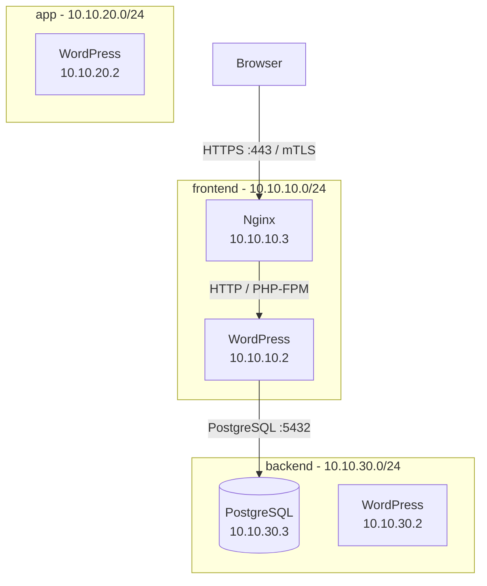
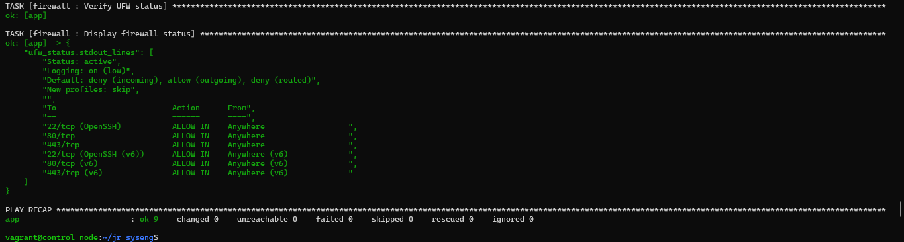
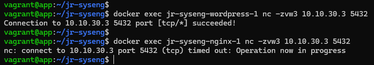
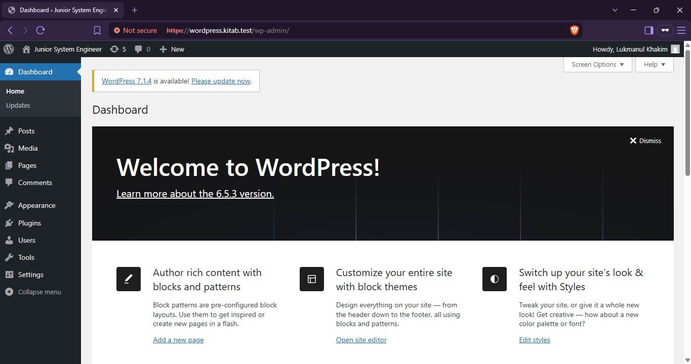
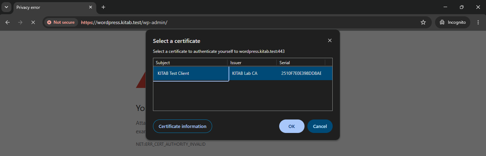
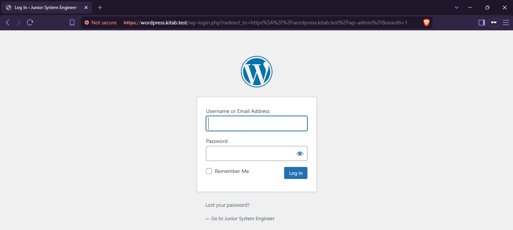

# Junior System Engineer — KITAB

Deployment WordPress dengan PostgreSQL dan Nginx menggunakan Docker Compose. Ansible digunakan untuk deployment dan konfigurasi firewall.

## Technology Stack & Versions

| Component | Version / Configuration |
|---|---|
| Virtualization | Oracle VirtualBox |
| VM Provisioning | Vagrant |
| Operating System | Ubuntu Server 22.04 LTS (Jammy) |
| Container Runtime | Docker Engine 29.9.2 |
| Container Orchestration | Docker Compose v5.6.1 |
| Reverse Proxy | Nginx 1.26-bookworm |
| Application | WordPress 6.5.3 with PHP 8.2-FPM |
| Database | PostgreSQL 14-bookworm |
| PostgreSQL Compatibility Layer | PG4WP v3.4.1 |
| Configuration Management | Ansible 2.10.8 |

## Arsitektur



| Host / container | IP | Fungsi |
|---|---|---|
| `control-node` | `192.168.56.18` | Ansible dan source project |
| `app` | `192.168.56.19` | Docker host |
| Nginx | `10.10.10.3` | Reverse proxy, HTTPS, mTLS |
| WordPress | `10.10.10.2`, `10.10.20.2`, `10.10.30.2` | Aplikasi; terhubung ke tiga network |
| PostgreSQL | `10.10.30.3` | Database; hanya di backend |

Network `frontend`, `app`, dan `backend` memakai subnet `10.10.10.0/24`, `10.10.20.0/24`, dan `10.10.30.0/24`. PostgreSQL hanya terhubung ke `backend`; port `5432` tidak dipublikasikan ke host dan tidak dapat diakses langsung dari Nginx.

## Komponen

- Dockerfile custom untuk Nginx, WordPress, dan PostgreSQL; ketiganya dibangun melalui `build:`.
- Semua container berjalan non-root (UID ≥ 10000) dan memiliki healthcheck.
- WordPress menggunakan PG4WP `v3.4.1` untuk kompatibilitas PostgreSQL.
- Nginx menangani HTTPS dan mewajibkan client certificate melalui mTLS.
- Ansible melakukan instalasi Docker, sinkronisasi project, deployment Compose, dan konfigurasi UFW.

## Deployment

Jalankan dari `control-node`. Siapkan `.env` berdasarkan `.env.example` dan pastikan file tersebut tidak di-commit.

```bash
cd ~/jr-syseng
make cert
ansible-playbook -i inventory/hosts.ini playbooks/deploy.yml
ansible-playbook -i inventory/hosts.ini playbooks/firewall.yml
```

Tambahkan pemetaan domain pada file `hosts` komputer yang digunakan untuk membuka browser:

```text
192.168.56.19 wordpress.kitab.test
```

Akses `https://wordpress.kitab.test`. Sertifikat server self-signed perlu dipercaya browser agar tidak muncul peringatan trust. Untuk mTLS, browser juga perlu memiliki client certificate yang ditandatangani CA lab.

## Verifikasi

```bash
# Status container
ansible app -i inventory/hosts.ini -m shell -a \
  "cd ~/jr-syseng && docker compose ps"

# Status firewall
ansible app -i inventory/hosts.ini -b -m shell -a "ufw status verbose"
```

UFW mengizinkan `22/tcp` (SSH), `80/tcp` (HTTP), dan `443/tcp` (HTTPS). Hasil deployment terakhir menunjukkan ketiga container `healthy`. Playbook firewall diuji ulang dengan `changed=0`.

### Verifikasi mTLS

| Pengujian | Hasil |
|---|---|
| Client tanpa certificate | `HTTP 400 Bad Request` — ditolak |
| Client dengan certificate valid | `HTTP 200 OK` — diterima |
| Browser dengan `KITAB Test Client` | Halaman login WordPress tampil |

Contoh pengujian dari `control-node`:

```bash
# Tanpa client certificate: diharapkan HTTP 400
curl -k -I --resolve wordpress.kitab.test:443:192.168.56.19 \
  https://wordpress.kitab.test/

# Dengan client certificate: diharapkan HTTP 200
curl -k -I \
  --cert docker/nginx/certs/mtls/client.crt \
  --key docker/nginx/certs/mtls/client.key \
  --resolve wordpress.kitab.test:443:192.168.56.19 \
  https://wordpress.kitab.test/
```

## Operasional

```bash
make build   # Build image
make up      # Jalankan aplikasi
make logs    # Lihat log
make down    # Hentikan aplikasi
make clean   # Hapus container, image lokal, volume, dan sertifikat
```

> `make clean` menghapus volume database sehingga data WordPress/PostgreSQL akan hilang.

## Bonus CI/CD

GitHub Actions berhasil menjalankan build dan publish image ke Docker Hub:

- `lukmankhakim09/jr-syseng-nginx`
- `lukmankhakim09/jr-syseng-wordpress`
- `lukmankhakim09/jr-syseng-postgres`

## Screenshot

| Bukti | Keterangan |
|---|---|
|  | Ketiga container berstatus healthy |
|  | WordPress dapat mengakses PostgreSQL, sedangkan Nginx tidak |
|  | UFW aktif dan port yang diizinkan |
|  | Dashboard WordPress melalui HTTPS |
|  | Browser meminta client certificate |
|  | Halaman login tampil setelah client certificate diterima |

## Keamanan

Jangan commit `.env`, `server.key`, `ca.key`, `client.key`, atau file `.p12`. `ca.crt` adalah sertifikat publik yang dipakai Nginx untuk memverifikasi client. Gunakan private key hanya pada host yang memerlukannya.

## Struktur utama

```text
.
├── .github/workflows/ci.yml
├── inventory/hosts.ini
├── playbooks/
├── roles/firewall/
├── docker/nginx/
├── docker/wordpress/
├── docker/postgres/
├── docs/screenshots/
├── compose.yml
├── Makefile
├── .env.example
└── README.md
```
