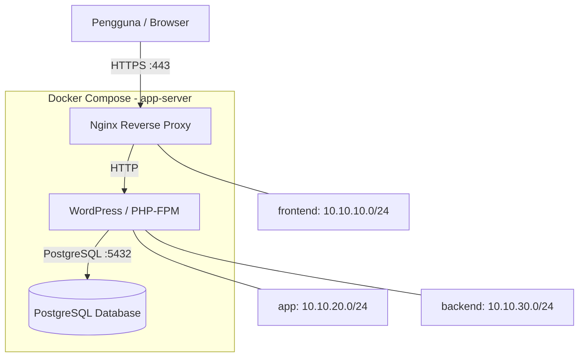

# Junior System Engineer - KITAB

## 1. Deskripsi Project

Project ini membuat aplikasi WordPress menggunakan Docker dengan PostgreSQL sebagai database dan Nginx sebagai reverse proxy.

Project juga menggunakan Ansible untuk mengatur server dan firewall.

## 2. Referensi

- **PG4WP (PostgreSQL for WordPress):** [GitHub Repository](https://github.com/PostgreSQL-For-Wordpress/postgresql-for-wordpress)
- **Dokumentasi PG4WP:** [README resmi proyek](https://github.com/PostgreSQL-For-Wordpress/postgresql-for-wordpress/blob/v3/readme.md)

PG4WP digunakan sebagai lapisan kompatibilitas agar WordPress dapat menggunakan PostgreSQL sebagai database. PG4WP merupakan proyek pihak ketiga, bukan komponen resmi WordPress.

Dalam project ini, PG4WP dipasang melalui Dockerfile WordPress menggunakan versi `v3.4.1`.

## 3. Technology Stack & Versions

| Component | Version / Configuration |
| Virtualization | Oracle VirtualBox |
| VM Provisioning | Vagrant |
| Operating System | Ubuntu Server 22.04 LTS (Jammy) |
| Container Runtime | Docker Engine 29.9.2 |
| Container Orchestration | Docker Compose v5.6.1 |
| Reverse Proxy | Nginx 1.26-bookworm |
| Application | WordPress 6.5.3 with PHP 8.2-FPM |
| Database | PostgreSQL 14-bookworm |
| PostgreSQL Compatibility Layer | PG4WP v3.4.1 |
| Configuration Management | Ansible 2.10.8 |

**Environment Overview**

- `control-node`: Ansible control machine used to automate deployment and firewall configuration.
- `app-server`: Target VM running the WordPress, PostgreSQL, and Nginx containers.
- `Vagrant + VirtualBox`: Used to provision and run the lab virtual machines.
- `Docker Compose`: Used to build and manage the multi-container application.


## 4. Arsitektur

### Diagram Arsitektur Aplikasi


## 5. Network dan IP Plan

### 5.1 IP Plan Docker Network

Project menggunakan tiga Docker bridge network untuk mendefinisikan segmentasi komunikasi layanan.

| Network | Subnet | Anggota | Fungsi |
|---|---|---|---|
| frontend | 10.10.10.0/24 | Nginx, WordPress | Jalur komunikasi reverse proxy ke aplikasi |
| app | 10.10.20.0/24 | WordPress | Network khusus aplikasi sesuai rancangan topologi |
| backend | 10.10.30.0/24 | WordPress, PostgreSQL | Jalur komunikasi aplikasi ke database |

### 5.2 IP Container

| Container | Network | IP |
|---|---|---|
| Nginx | frontend | 10.10.10.3 |
| WordPress | frontend | 10.10.10.2 |
| WordPress | app | 10.10.20.2 |
| WordPress | backend | 10.10.30.3 |
| PostgreSQL | backend | 10.10.30.2 |

Alamat di atas merupakan hasil verifikasi saat deployment. IP container dapat berubah apabila container atau network dibuat ulang.

WordPress terhubung ke frontend untuk menerima request dari Nginx dan ke backend untuk mengakses PostgreSQL. Network `app` saat ini hanya memiliki WordPress sebagai anggotanya. PostgreSQL tidak tergabung dalam frontend dan tidak memublikasikan port ke host.

Network backend menggunakan opsi `internal: true` untuk membatasi konektivitas eksternal melalui network tersebut.

### 5.3 IP Plan Host

| Host | IP host-only | Peran |
|---|---|---|
| control-node | 192.168.56.16 | Menjalankan Ansible dan menyimpan source project |
| app-server | 192.168.56.17 | Menjalankan Docker Engine, Compose, dan seluruh container aplikasi |

Kedua VM menggunakan jaringan host-only VirtualBox `192.168.56.0/24` untuk komunikasi antara control-node dan app-server. Subnet Docker `10.10.10.0/24`, `10.10.20.0/24`, dan `10.10.30.0/24` merupakan jaringan internal layanan container, bukan alamat host VM.

### 5.4 Alasan Segmentasi

- **Frontend:** memisahkan jalur akses reverse proxy dan aplikasi dari database.
- **App:** menyediakan network aplikasi tersendiri sesuai rancangan topologi.
- **Backend:** membatasi keanggotaan network database pada WordPress dan PostgreSQL.
- **Host-only:** memungkinkan Ansible mengelola app-server melalui jaringan lab tanpa menggunakan alamat container sebagai alamat host.

Segmentasi ini membatasi konektivitas berdasarkan keanggotaan network. Ini bukan pengganti autentikasi database atau pengujian keamanan menyeluruh.

## 6. Persiapan

Pastikan perangkat berikut tersedia:

- Ubuntu Server
- Docker
- Docker Compose
- Ansible
- OpenSSL
- Git

## 7. Konfigurasi Environment

Buat file `.env`, kemudian isi konfigurasi database.

Contoh variabel:

- POSTGRES_DB
- POSTGRES_USER
- POSTGRES_PASSWORD

Gunakan password yang kuat. Jangan mengunggah file `.env` yang berisi password ke GitHub.

## 8. Menjalankan Aplikasi

Masuk ke direktori project:

```bash
cd jr-syseng
```

Buat sertifikat HTTPS:

```bash
make cert
```

Build image:

```bash
make build
```

Jalankan aplikasi:

```bash
make up
```

Melihat status container:

```bash
docker compose ps
```

Melihat log aplikasi:

```bash
make logs
```

Menghentikan aplikasi:

```bash
make down
```

Menghapus container, image lokal, volume, dan sertifikat project:

```bash
make clean
```

Perhatian: perintah `make clean` menghapus volume database, sehingga data WordPress dapat hilang.

## 9. Akses HTTPS

Domain lab:

https://wordpress.kitab.test

Tambahkan konfigurasi berikut pada file hosts di komputer yang digunakan untuk membuka browser:

```text
192.168.56.17 wordpress.kitab.test
```

Project menggunakan sertifikat self-signed. Browser dapat menampilkan peringatan keamanan karena sertifikat dibuat sendiri untuk kebutuhan lab.

## 10. Firewall dengan Ansible

Firewall dikonfigurasi menggunakan UFW melalui Ansible.

Port yang diizinkan:

| Port | Fungsi |
|---|---|
| 22 | SSH untuk administrasi server |
| 80 | HTTP |
| 443 | HTTPS |

Menjalankan konfigurasi firewall:

```bash
ansible-playbook -i inventory/hosts.ini playbooks/firewall.yml
```

Memeriksa status firewall:

```bash
ansible app-server -i inventory/hosts.ini -b -m command -a "ufw status"
```

Hasil verifikasi:

- Status UFW: active
- SSH: diizinkan
- HTTP: diizinkan
- HTTPS: diizinkan
- Eksekusi playbook kedua: tidak menghasilkan perubahan baru (changed=0)

Hasil tersebut menunjukkan konfigurasi firewall dapat dijalankan berulang kali tanpa perubahan yang tidak diperlukan.

## 11. Verifikasi Container

Memeriksa status container:

```bash
ansible app-server -i inventory/hosts.ini -m shell -a "cd ~/jr-syseng && docker compose ps"
```

Hasil verifikasi:

- Nginx: healthy
- WordPress: healthy
- PostgreSQL: healthy

Pemeriksaan user container:

- Nginx: UID 10003
- WordPress: UID 10002
- PostgreSQL: UID 10001

Ketiga container berjalan menggunakan UID minimal 10000.

Verifikasi database menunjukkan 12 tabel WordPress berhasil dibuat di PostgreSQL.

## 12. Bukti Dokumentasi

Screenshot pada folder `docs/screenshots/`:

1. Website WordPress berhasil dibuka melalui HTTPS.
2. Status container menunjukkan ketiga layanan healthy.
3. Hasil pemeriksaan UID container.
4. Hasil pemeriksaan network Docker.
5. Status UFW active dan daftar port yang diizinkan.
6. Eksekusi kedua playbook firewall dengan changed=0.

## 13. Struktur Project

```text
jr-syseng/
├── ansible.cfg
├── inventory/
│   └── hosts.ini
├── playbooks/
│   ├── deploy.yml
│   ├── firewall.yml
│   └── install-docker.yml
├── roles/
│   └── firewall/
│       └── tasks/
│           └── main.yml
├── docker/
│   ├── nginx/
│   │   ├── Dockerfile
│   │   ├── openssl.cnf
│   │   ├── conf/
│   │   │   └── nginx.conf
│   │   └── certs/             # Sertifikat lokal, tidak di-commit
│   ├── wordpress/
│   │   ├── Dockerfile
│   │   └── www.conf
│   └── postgres/
│       └── Dockerfile
├── compose.yml
├── Makefile
├── .env.example
├── .gitignore
└── README.md
```
